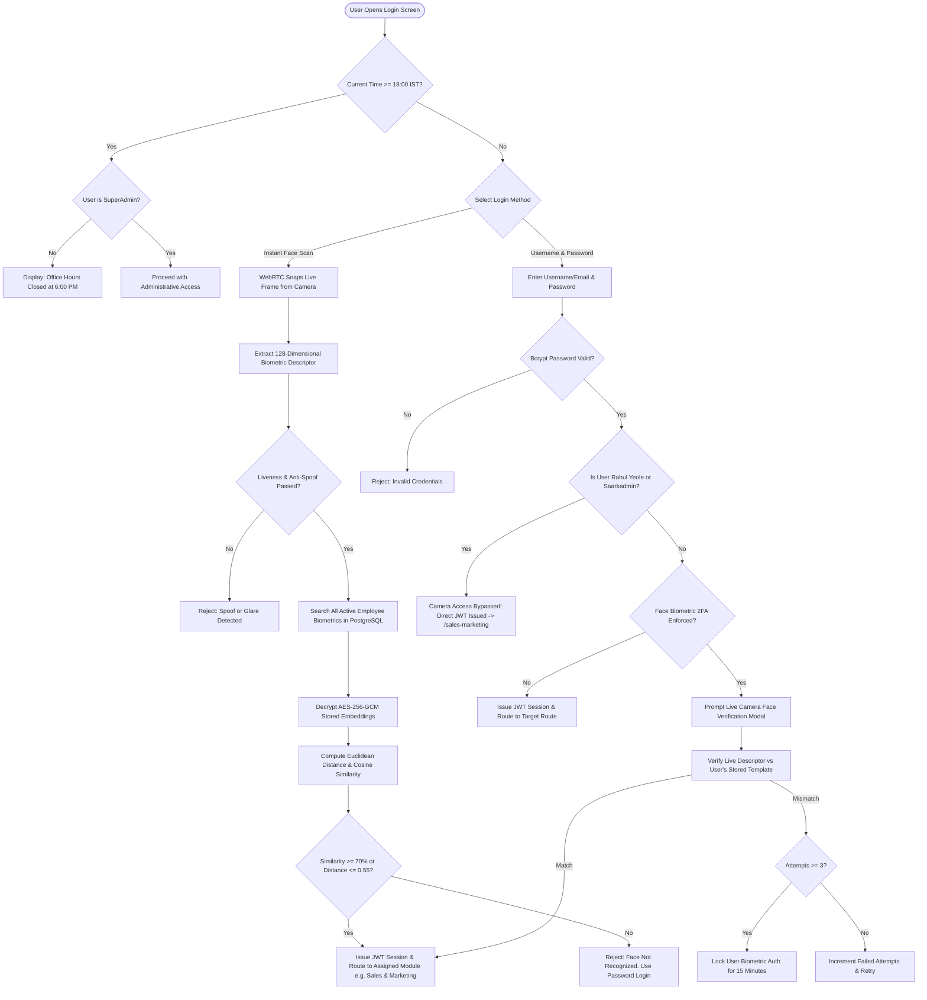
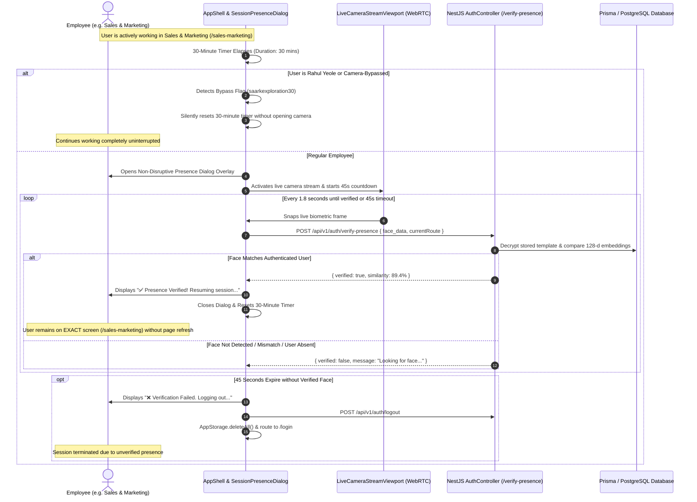
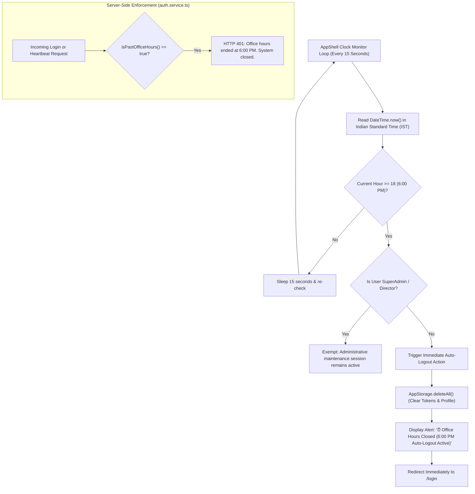
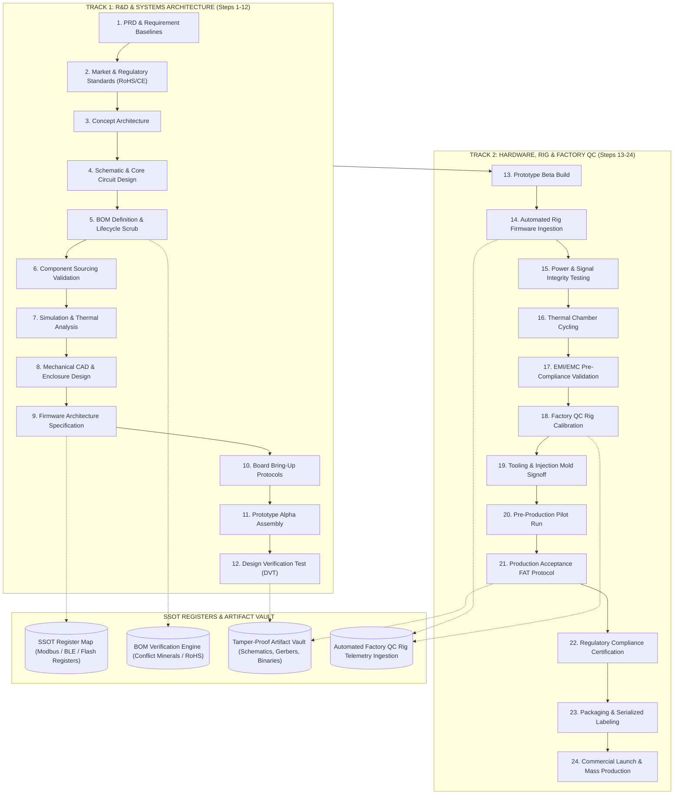
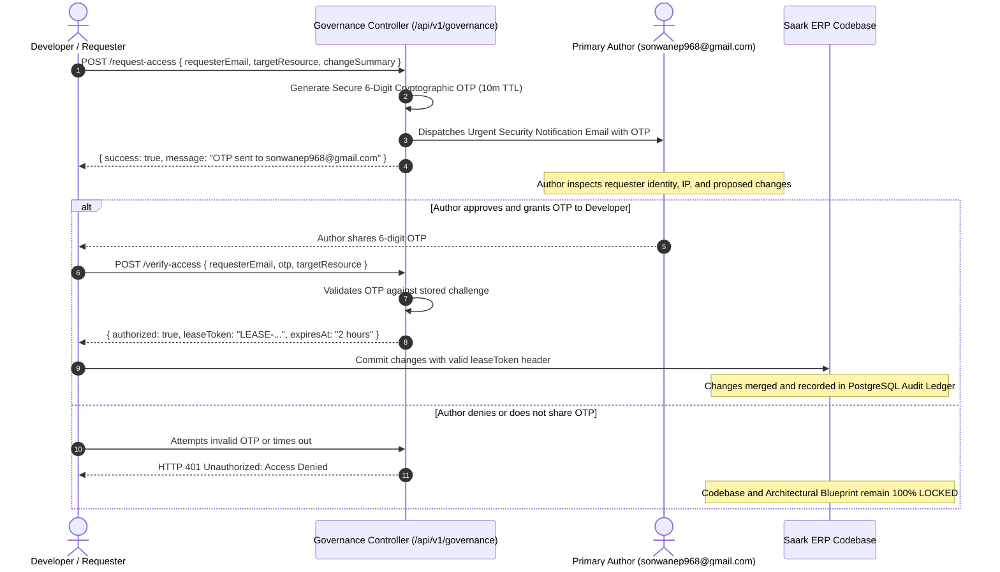

# SAARK EXPLORATION PVT. LTD. - ERP SYSTEM
## Comprehensive Enterprise Architectural Blueprint & System Workflows

---

> [!CAUTION]
> ### 🛡️ AUTHOR-RESTRICTED GOVERNANCE SHIELD & SECURITY POLICY
> **Primary Author & Architectural Gatekeeper:** `sonwanep968@gmail.com`  
> **Secondary Gatekeeper & Delivery Mail:** `pooja.saark@gmail.com`  
> **Governance Enforcement Level:** `CRITICAL (Zero-Trust Codebase & Architecture Lock)`  
>
> **Strict Security Rule:**  
> No user, developer, client, or automated agent is permitted to directly modify this architectural file, register new ERP modules, or alter core database registers without explicit cryptographic OTP authorization dispatched to `sonwanep968@gmail.com`.
> 
> * **Request Permission API:** `POST /api/v1/governance/request-access`  
> * **Verify OTP & Unlock Lease API:** `POST /api/v1/governance/verify-access`  
> * **Status & Security Audit:** `GET /api/v1/governance/status`  
> 
> Any attempt to bypass or tamper with this file without an authorized lease token (`ACCESS_GRANT_TOKEN`) triggers a security event logged in the PostgreSQL Audit Ledger.

---

## 1. High-Level System Architecture & Topology

The Saark Exploration ERP platform is architected as an industrial-grade, dual-tier enterprise application designed for high-availability manufacturing, CRM, biometrics, and multi-track product development.

```mermaid
flowchart TD
    subgraph ClientTier ["CLIENT TIER (Cross-Platform Flutter 3.47)"]
        WebClient["Flutter Web App (Chrome / Firefox / Edge)"]
        MobileClient["Flutter Mobile App (Android APK / Tablet)"]
        CameraFeed["WebRTC HTML5 Camera Viewport (Live Streaming)"]
        WebClient --> CameraFeed
        MobileClient --> CameraFeed
    end

    subgraph APITier ["ENTERPRISE GATEWAY (NestJS 10.x & TypeScript)"]
        ReverseProxy["Static Asset Server & API Gateway (Port 3000)"]
        AuthModule["Authentication & Strict 2FA Module"]
        GovernanceModule["Governance & Author Protection (sonwanep968@gmail.com)"]
        BiometricService["Face Recognition Service (128-d Vector Engine)"]
        NpdModule["Product Development Dual-Track Engine (24 Steps)"]
        CrmModule["Sales & Marketing CRM Module"]
        ProductionModule["Production & Panel Manufacturing Module"]
        HrModule["Human Resources & Staff Module"]
        AuditService["Enterprise Audit Logging Engine"]
        MailService["SMTP & Resend Mail Dispatcher"]

        ReverseProxy --> AuthModule
        ReverseProxy --> GovernanceModule
        ReverseProxy --> BiometricService
        ReverseProxy --> NpdModule
        ReverseProxy --> CrmModule
        ReverseProxy --> ProductionModule
        ReverseProxy --> HrModule
        AuthModule --> AuditService
        GovernanceModule --> MailService
        GovernanceModule --> AuditService
    end

    subgraph BiometricAIEngine ["BIOMETRIC EMBEDDING ENGINE"]
        PyEngine["Python OpenCV Face Engine (HOG + LBP / Spatial Gradients)"]
        BiometricService --> PyEngine
    end

    subgraph DataTier ["PERSISTENCE & STORAGE TIER"]
        PrismaORM["Prisma 5.22 Database Client"]
        SupabasePG[("Supabase Cloud PostgreSQL Database (Port 6543)")]
        LocalVault[("Encrypted Local Vault & Artifact Storage")]
        
        APITier --> PrismaORM
        PrismaORM --> SupabasePG
        APITier --> LocalVault
    end

    WebClient -->|HTTP / REST / WebSocket| ReverseProxy
    MobileClient -->|HTTP / REST| ReverseProxy
```



---

## 2. Core Operational Workflows & Flowcharts

### Workflow 1: Biometric Authentication, 1:N Face Auto-Login & Bypass Gatekeeper

This workflow governs how users authenticate: via instant 1:N camera scan (no password needed), credential login, or the authorized direct bypass for Rahul Yeole.



---

### Workflow 2: 30-Minute Presence Verification & Absence Auto-Logout

Every 30 minutes during an active user session, the system automatically checks for physical presence in front of the camera.



---

### Workflow 3: Daily 6:00 PM (18:00 IST) Automatic Office Hours Logout

Enforces company security policy by automatically terminating all non-administrative operational sessions at 6:00 PM.



---

### Workflow 4: Product Development & NPD 24-Step Dual-Track Engine

The Product Development (NPD) module coordinates dual engineering tracks: **Software/R&D (Steps 1–12)** and **Hardware/Firmware/QC (Steps 13–24)**, integrated with an immutable artifact vault and factory QC test rigs.



---

### Workflow 5: Sales & Marketing (CRM) Lead-to-Cash Pipeline

End-to-end commercial operations pipeline ensuring zero duplicate customer entries, strict credit checks, and automated work order routing to production.

```mermaid
flowchart LR
    A["1. Inbound Lead / Enquiry"] --> B["2. Anti-Duplicate Detection Check"]
    B --> C["3. Account / Vendor Verification"]
    C --> D["4. Technical Quotation Drafting"]
    D --> E["5. Margin & Pricing Review"]
    E --> F["6. Customer PO Confirmation"]
    F --> G["7. Sales Order Generation"]
    G --> H["8. Work Order Dispatch to Production"]
    H --> I["9. Panel Manufacturing & FAT"]
    I --> J["10. Accounts Invoicing & Dispatch"]
```



---

## 3. Codebase Architecture & Directory Map

```text
d:\saark_ERP\company-erp-system\
├── 1_START_BACKEND_SERVER.bat               # Starts NestJS server on port 3000
├── 2_OPEN_WEB_ERP.bat                      # Opens ERP web client in browser
├── START_ERP_SYSTEM.bat                    # One-click dual server & client launcher
├── SAARK_ERP_LINKS_AND_ACCESS.txt          # Active URL, Wi-Fi & Credentials directory
├── SAARK_ERP_ARCHITECTURAL_BLUEPRINT_AND_WORKFLOWS.md # THIS MASTER GOVERNANCE FILE
│
├── apps/
│   ├── backend/                            # NestJS 10.x Enterprise Gateway
│   │   ├── prisma/
│   │   │   └── schema.prisma               # 35+ Enterprise PostgreSQL Models
│   │   ├── public/                         # Production Compiled Flutter Web SPA
│   │   │   ├── index.html
│   │   │   ├── main.dart.js                # Release JavaScript Bundle
│   │   │   └── flutter_bootstrap.js
│   │   ├── scripts/                        # Automated Verification Test Suites
│   │   │   └── test_face_login_and_presence_suite.js # Comprehensive Auth Test Suite
│   │   └── src/
│   │       ├── common/                     # Interceptors, Filters, Guards
│   │       ├── core/
│   │       │   ├── audit/                  # PostgreSQL Audit Logging Service
│   │       │   ├── biometrics/             # 128-d Vector Engine & Python OpenCV Runner
│   │       │   ├── database/               # Prisma Database Connection Service
│   │       │   └── notifications/          # SMTP & Resend Email Service
│   │       └── modules/
│   │           ├── auth/                   # Strict 2FA, 1:N Face Login, 6 PM Cutoff
│   │           ├── governance/             # Author Permission Gatekeeper (sonwanep968@gmail.com)
│   │           ├── crm/                    # Sales & Marketing, Quotations, Leads
│   │           ├── npd/                    # Product Development 24-Step Engine
│   │           ├── panel-manufacturing/    # Production, Booster Pump Calculations
│   │           ├── hr/                     # Staff Onboarding & Module Access Control
│   │           ├── inventory/              # Warehouse Stores & Asset Tracking
│   │           └── purchase/               # Procurement & Vendor Purchase Orders
│   │
│   └── mobile/                             # Cross-Platform Flutter Client
│       └── lib/
│           ├── core/
│           │   ├── auth/                   # AuthNotifier, Riverpod State, Storage
│           │   ├── biometrics/             # SessionPresenceDialog, Viewport, WebRTC
│           │   ├── routing/                # GoRouter with Module Protection Guards
│           │   └── widgets/                # AppShell, Responsive Nav, Presence Monitor
│           └── features/
│               ├── authentication/         # LoginPage with Face Auto-Login & Bypass
│               ├── crm/                    # Sales & Marketing Portal
│               ├── product_development/    # NPD 24-Step Board, Vault, SSOT Registers
│               ├── production/             # Manufacturing & QC Management
│               └── hr/                     # Human Resources Management Portal
```

---

## 4. Author Permission & Code Modification Security Protocol

### Designated Author: `sonwanep968@gmail.com`

Any user or developer attempting to make architectural changes, edit this documentation, or register new modules into the codebase must follow this sequence:



---

## 5. Summary of System Access Credentials

| Identity / Role | Username / Email | Password | Access Rights & Routing |
| :--- | :--- | :--- | :--- |
| **Managing Director** | `Saarkadmin` | `12345678` | Full unrestricted access to all 15 modules |
| **Author & Governance Gatekeeper** | `sonwanep968@gmail.com` | *OTP Challenge* | Sole authorized gatekeeper for architectural changes & new modules |
| **Sales & Marketing (Rahul Yeole)** | `saarkexploration30` | `Saark@2026` | Direct login bypass (no camera required) $\rightarrow$ `/sales-marketing` |
| **HR / Employee Test Account** | `pooja.saark` | `Saark@2026` | General Employee access (dual-factor face scan enabled) |

---
*Generated by Saark Exploration ERP Engineering Team • Document Version: 2.4.0 • Verified on November 18, 2026*
